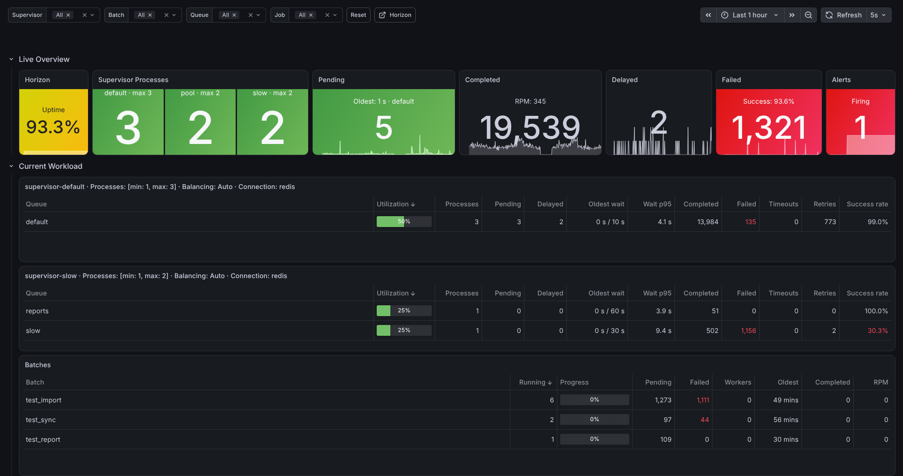

# Horizon Observability

Prometheus metrics, live job lists, a Grafana dashboard and alert rules for Laravel Horizon and its Redis queues.

## Quick start

You need a Laravel app with Horizon installed (`composer require laravel/horizon && php artisan horizon:install`),
Redis on the app's default connection (the phpredis extension, or `predis/predis` with `REDIS_CLIENT=predis`), and
Docker with Compose. Only jobs on a `redis` queue connection that Horizon works are counted (never `sync`,
`database`, deferred or background ones), so set `QUEUE_CONNECTION=redis` in `.env` for your own jobs: a new Laravel
app has `database`. The demo jobs of step 2 use Horizon's `redis` connection either way.

**1. Install the package**

```bash
composer require sushi-market/horizon-observability
```

**2. Run the installer**

```bash
php artisan horizon-observability:install --docker --demo
```

Press Enter to accept the defaults. Most of the output is the setup for your own Prometheus and Grafana, for later.
The installer ends with three next steps. Run each one in its own terminal:

```bash
php artisan serve --host=0.0.0.0 --port=8000
php artisan horizon
docker compose -f docker-compose.observability.yml up -d
```

Grafana answers within about a minute of `up -d`: it first waits for Prometheus to scrape the app (up to 60 s), then
installs its two plugins.

**3. Open Grafana**

Open the URL the installer printed: <http://localhost:3000/d/horizon-observability> (with `GRAFANA_PORT` set, that
port, see the notes below). Anonymous visitors can view it, and `admin` / `admin` logs in. The provisioned dashboard
is read-only: use Save as to keep a changed copy.



The end-to-end test `tests/e2e/first-dashboard.sh` runs these steps on a fresh `laravel/laravel` app. It must reach a
dashboard with data within 5 minutes of `composer require`.

What the installer did:

- published `config/horizon-observability.php`;
- wrote a 40-character `HORIZON_OBSERVABILITY_TOKEN` to `.env` (it never overwrites an existing value) and an empty
  placeholder to `.env.example`;
- wrote `docker-compose.observability.yml` and `docker/observability/**`: Prometheus scraping the app every 10 s with
  that token, and Grafana 13 with the plugins, both datasources, the dashboard (also the home page) and the alert rules;
- dispatched 200 sample jobs (completed, failed, retried, released and delayed ones, plus one batch);
- ran the checks of `horizon-observability:check` and printed each problem with a fix line.

Expected on a new app:

- The installer's checks report one warning, "Horizon, Status: not running", until you start `php artisan horizon`.
  In the `local` environment, missing Redis timeouts are info, so `horizon-observability:check` lists them without a
  warning.
- The Horizon tile is yellow at first: its Uptime is the share of the dashboard range (the last hour) in which Horizon
  ran, and a running Horizon below 99 % is yellow.
- The alert "High failure rate" is pending, and fires 5 minutes later, because the demo fails 10 % of its jobs on
  purpose. A firing rule makes the dashboard ring (a browser may need a click on the page first). The alert resolves
  about 15 minutes after the burst.
- The Completed and Failed numbers of a new job class, in the tiles, the tables and the Batches table, stay at 0 for
  up to 90 s after its first attempt (the [new-series hold](#dashboard-numbers)). Pending, Delayed and Supervisor
  Processes show at once. Progress in the Batches table reads "—" when no batch of the kind is running; the demo batch
  finishes within seconds.

Notes:

- Running the installer again (without `--demo`) changes nothing.
- Port 8000 taken? Set `APP_URL=http://localhost:8080` in `.env` before you run the installer. The stack then scrapes
  port 8080, the installer prints `php artisan serve --host=0.0.0.0 --port=8080`, and the Endpoints and Horizon lines
  and the dashboard's Horizon link use that port too. `--app-url=<url>` changes only the URL at which the containers
  reach the app.
- Port 3000 or 9090 taken? Add `GRAFANA_PORT=3001` and `PROMETHEUS_PORT=9091` to `.env` before you run the installer
  (Docker Compose reads the `.env` next to the compose file). The installer then prints
  <http://localhost:3001/d/horizon-observability>.
- `--grafana=12` uses Grafana 12.4.13 instead of 13.2.4.
- To change an option or `APP_URL` after a first run, run the installer again with `--force`, or answer yes when it
  asks to overwrite a file.
- More sample jobs: `php artisan horizon-observability:demo --jobs=500` (1 to 1000; refuses in production).
- The stack is for local use only: its ports listen on 127.0.0.1, and anonymous visitors can view Grafana.
- Stop it with `docker compose -f docker-compose.observability.yml down`. Add `-v` to drop its data.

## Contents

- [Requirements](#requirements)
- [Production setup](#production-setup)
- [Live Overview modes](#live-overview-modes)
- [Operations](#operations)
- [Configuration reference](#configuration-reference)
- [Metrics](#metrics)
- [Performance and scrape interval](#performance-and-scrape-interval)
- [Known limitations](#known-limitations)
- [Upgrading from the pilot](#upgrading-from-the-pilot)

## Requirements

| Component | Supported |
|---|---|
| PHP | 8.2 or later |
| Laravel | 11.23 or later, 12, 13 |
| Laravel Horizon | 5.29.1 or later (5.x) |
| Redis client | phpredis (recommended) or `predis/predis` ^2.0.2 or ^3.0 |
| Redis server | Redis 6.2 or later, or Valkey 7.2 or later; standalone or Redis Cluster. CI runs Redis 6.2, 7.4 and 8 and Valkey 7.2 and 8 |
| Prometheus | tested with 3.15.0. The Alerts tile and the alert sound need `--web.enable-remote-write-receiver` |
| Grafana | 12.3 or later, or 13 (tested with 12.4.13 and 13.2.4), with the plugins [Infinity](https://grafana.com/grafana/plugins/yesoreyeram-infinity-datasource/) 4.1.1+ and [Business Text](https://grafana.com/grafana/plugins/marcusolsson-dynamictext-panel/) 6.3.0+ |

The package has no other runtime dependencies.

Redis notes:

- The package scripts call `TIME`, `INFO` and `HGETALL` before they write, so they need effects replication. That is
  the default since Redis 5 and the only mode in Redis 7 and Valkey. A Redis 6.2 configured with
  `lua-replicate-commands no` is not supported.
- With Redis ACLs, the package's user needs `EVAL` and the commands the scripts call, including `TIME` (`+time`, part
  of `@fast`). Without `TIME`, attempts are still recorded, but the attempts collector reports a failure and new series
  skip the [90 s hold](#dashboard-numbers). `horizon-observability:check` names a refused command and the
  `ACL SETUSER` rule that allows it.
- On a Redis Cluster, all package keys share one hash slot.

## Production setup

Without `--docker`, the installer prints the snippets of this section with your app URL, job name and paths:

```bash
php artisan horizon-observability:install            # --no-env prints the token instead of writing .env
```

You can also publish the config with `php artisan vendor:publish --tag=horizon-observability-config` and set the
environment variables yourself.

### Endpoints

All endpoints live under `{base}`. By default that is `/{horizon.path}/observability` (`/horizon/observability`), or
`HORIZON_OBSERVABILITY_PATH` when it is set.

| Endpoint | Used by | Token |
|---|---|---|
| `GET {base}/metrics` | Prometheus (text format 0.0.4) | `token` |
| `GET {base}/jobs/{pending,completed,failed,delayed}` | the dashboard's job lists (Infinity) | `api_token`, else `token` |
| `GET {base}/live` | the Live Overview in poll mode (Infinity); absent when `live.enabled` is false | `api_token`, else `token` |

- The routes sit outside the `web` and `horizon` middleware groups: no session, no cookies, no Horizon gate.
- They are registered ahead of Horizon's catch-all route, with or without `route:cache`.
- They stay reachable during `php artisan down` (`available_during_maintenance`).
- `HORIZON_OBSERVABILITY_DOMAIN` limits them to one host. Horizon's domain is not inherited.
- The metrics endpoint answers 200 to every authorised request. When a source fails, its families are left out and
  `ho_exporter_collector_success{collector="..."}` is 0.

### Access: tokens, IP allow-list, callback

| Configured | Result |
|---|---|
| nothing | open in the `local` environment only, 403 everywhere else (`check` reports it as an error) |
| `HORIZON_OBSERVABILITY_TOKEN` | `Authorization: Bearer <token>` required; a missing or wrong token gets 401 |
| `HORIZON_OBSERVABILITY_API_TOKEN` | a separate token for the job lists and `/live`, so Grafana can hold a different secret from Prometheus |
| `HORIZON_OBSERVABILITY_ALLOWED_IPS` | IPs or CIDRs, comma-separated; a mismatch gets 403. Combined with tokens, both must pass |
| `HorizonObservability::auth()` | your callback alone decides: `true` allows, anything else gets 403 |

- **Tokens.** Each token needs at least 16 characters. Shorter ones are ignored and reported, and a list without a
  valid token lets nothing through. The token is read from the `Authorization` header only, never from the query
  string, and is never logged. A denied request does no cache, database or Redis work.
- **Rotation.** Both settings take a comma-separated list. To rotate:
  1. set `old,new` on every app server;
  2. switch Prometheus' credentials file and Grafana's datasource token to `new`;
  3. drop `old`.
- **IP allow-list.** The check uses `$request->ip()`, so configure Laravel's trusted proxies correctly. `check` warns
  when IPs are the only control.
- **Callback.** For mTLS or VPN headers, or a custom gate. Call it in a service provider's `boot()`, as you would
  `Horizon::auth()`:

  ```php
  use DF\HorizonObservability\HorizonObservability;
  use Illuminate\Http\Request;

  HorizonObservability::auth(fn (Request $request): bool => $request->header('X-Client-Verify') === 'SUCCESS');
  ```

- **Throttling.** None by default. All Grafana viewers' requests come from the Grafana server, so a shared limit would
  blank the tables during an incident. To add a limit anyway, set `'middleware' => ['throttle:600,1']`; it runs after
  authorization.

### Prometheus

Give the package endpoint a scrape job of its own, separate from any per-pod app metrics. Store the token in a
credentials file:

```yaml
scrape_configs:
  - job_name: myapp-horizon                 # the dashboard's prometheus_job (--job of the render)
    metrics_path: /horizon/observability/metrics
    scheme: https
    scrape_interval: 10s                    # recommended; 5s to 60s are supported
    scrape_timeout: 8s
    authorization:
      type: Bearer
      credentials_file: /etc/prometheus/secrets/horizon-observability-token   # HORIZON_OBSERVABILITY_TOKEN
    static_configs:
      - targets: ['myapp.internal:443']     # ONE logical target: the load balancer, Service or host
```

- **One target per app environment.** Every series is read from shared Redis or the database, so every replica returns
  the same values. Scrape the load balancer or the Service name, not each pod. The dashboard and the alert rules
  deduplicate copies (`max by (job, ...)`). The opt-in `--health-rules` include an alert for a job with more than one
  target.
- **Interval.** 10 s is recommended; 5 s to 60 s are supported. At 5 s, set `scrape_timeout: 5s` or less. The exporter
  works within `min(8 s, scrape_timeout - 0.5 s)`; a collector that would start after that deadline is skipped and
  reported with `ho_exporter_collector_success 0`.
- **Render the dashboard for your interval** when it is not 10 s: `--scrape-interval=30s` (see [Grafana](#grafana)).
- **Alerts tile and alert sound.** Start Prometheus with `--web.enable-remote-write-receiver`, so Grafana can write its
  alert state history there (see the next section).

### Grafana

**Plugins.** Install Infinity and Business Text, for example with
`GF_PLUGINS_PREINSTALL_SYNC=yesoreyeram-infinity-datasource@4.1.1,marcusolsson-dynamictext-panel@6.3.0`.

**Prometheus datasource.** The dashboard uses Grafana's default datasource; `--prometheus-datasource=<name regex>`
picks another one. Two settings matter:

```yaml
apiVersion: 1
datasources:
  - name: Prometheus
    uid: prometheus
    type: prometheus
    access: proxy
    url: http://prometheus:9090
    isDefault: true
    jsonData:
      httpMethod: POST        # required: panels send 10 to 25 KB of PromQL
      timeInterval: 10s       # your scrape interval
```

**Infinity datasource.** The job lists and the poll mode read the app through it. Grafana calls the app server-side,
so the token never reaches a browser. The example is
[`resources/grafana/provisioning/datasources/horizon-observability.yaml`](resources/grafana/provisioning/datasources/horizon-observability.yaml);
adapt the health check path when you changed the base path:

```yaml
apiVersion: 1
datasources:
  - name: Horizon Observability API
    uid: horizon-observability-api
    type: yesoreyeram-infinity-datasource
    access: proxy
    url: ${HORIZON_OBSERVABILITY_APP_URL}        # internal base URL of the app, reachable from Grafana
    jsonData:
      auth_method: bearerToken
      allowedHosts: ['${HORIZON_OBSERVABILITY_APP_URL}']
      customHealthCheckEnabled: true
      customHealthCheckUrl: ${HORIZON_OBSERVABILITY_APP_URL}/horizon/observability/jobs/pending?limit=1
    secureJsonData:
      bearerToken: ${HORIZON_OBSERVABILITY_API_TOKEN}   # the app's API token (or its token)
```

**Alert state history.** The Alerts tile and the alert sound read Grafana's alert state history from Prometheus
(`GRAFANA_ALERTS`). Merge [`resources/grafana/provisioning/grafana.ini.example`](resources/grafana/provisioning/grafana.ini.example)
into `grafana.ini`, or set the equivalent variables:

```bash
GF_UNIFIED_ALERTING_STATE_HISTORY_ENABLED=true
GF_UNIFIED_ALERTING_STATE_HISTORY_BACKEND=multiple
GF_UNIFIED_ALERTING_STATE_HISTORY_PRIMARY=annotations
GF_UNIFIED_ALERTING_STATE_HISTORY_SECONDARIES=prometheus
GF_UNIFIED_ALERTING_STATE_HISTORY_PROMETHEUS_TARGET_DATASOURCE_UID=<uid of your Prometheus datasource>
```

**Dashboard and alert rules.** Render both with the app's config. The metric prefix follows
`HORIZON_OBSERVABILITY_NAMESPACE`:

```bash
php artisan horizon-observability:grafana grafana --job=myapp-horizon
# writes grafana/dashboards/horizon-observability.json and grafana/alerting/horizon-observability.json
```

Then provision them:

- Mount `grafana/dashboards` at `/etc/grafana/dashboards/horizon-observability`, with the provider
  [`resources/grafana/provisioning/dashboards/horizon-observability.yaml`](resources/grafana/provisioning/dashboards/horizon-observability.yaml)
  (folder `Horizon`, no edits in the UI, reloaded every 10 s).
- Mount `grafana/alerting` at `/etc/grafana/provisioning/alerting`.
- The alert rules read the uid of the Prometheus datasource from `HORIZON_OBSERVABILITY_PROMETHEUS_UID` in Grafana's
  environment. Alternatively, render with `--datasource-uid=<uid>`.

To keep a committed render in sync, for example in the CI of an infrastructure repository, add `--check`: it exits 1
when the files differ from the render. `php artisan vendor:publish --tag=horizon-observability-grafana` copies the
package's whole `resources/grafana` into `grafana/`: its own render made with `--defaults --recording-rules` (poll
mode, all jobs: `dashboards/`, `alerting/` and `prometheus/horizon-observability.rules.yml`), the examples in
`provisioning/` (the Infinity datasource, the dashboard provider and `grafana.ini.example`), and `js/alert-sound.js`,
the source of the alert sound script that the dashboard already contains.

| Option | Default | Meaning |
|---|---|---|
| `path` (argument) | `grafana` | output directory, relative to the app root |
| `--job=` | all jobs | the Prometheus job the dashboard selects and the alert rules are scoped to |
| `--scrape-interval=` | `10s` | the scrape interval of the package job, 5s to 60s: the panels' min interval, the busy window, the counter lookback, the refresh |
| `--live=` | `poll` (`off` while `live.enabled` is false) | `off`, `poll` or `stream`, see [Live Overview modes](#live-overview-modes) |
| `--live-poll-interval=` | `5s` | poll mode: the dashboard refresh, 1s to 5m (Grafana raises it to its `min_refresh_interval`) |
| `--live-stream-id=` | `live.stream.id` | stream mode: the Grafana Live stream id; it must match the stream command's |
| `--uid=` | `horizon-observability` | dashboard uid; the alert rule uids start with it |
| `--title=` | `Queues` | dashboard title |
| `--folder=` | `Horizon` | Grafana folder of the alert rules |
| `--datasource-uid=` | `${HORIZON_OBSERVABILITY_PROMETHEUS_UID}` | uid of the Prometheus datasource of the alert rules |
| `--prometheus-datasource=` | Grafana's default | name regex of the Prometheus datasource |
| `--infinity-datasource=` | the first one | name regex of the Infinity datasource |
| `--down-for` | `5m` | how long Horizon must be paused or not running before "Horizon is down" fires, `0s` to `60m`; the rules are evaluated every minute, so `1m` fires one to two minutes after Horizon stops |
| `--health-rules` | off | add the rules "Metrics collector failing" and "Duplicate metrics exporters" |
| `--recording-rules` | off | also write `prometheus/horizon-observability.rules.yml` (the dashboard does not read them) |
| `--defaults` | off | ignore the app config (the metric prefix still follows the namespace) |
| `--check` | off | compare instead of writing; exit 1 on a difference |

Alert rules (evaluated every minute):

| Rule (uid suffix) | Fires when |
|---|---|
| No queue metrics (`-no-metrics`) | Prometheus has no `ho_horizon_status` for 5 minutes |
| Horizon is down (`-down`) | Horizon is paused or has no master supervisor, for 5 minutes (`--down-for`) |
| Queue wait over 2x limit (`-long-wait`) | the oldest pending job of a queue waits more than twice its `horizon.waits` threshold, for 5 minutes |
| High failure rate (`-failures`) | failed and timed-out attempts are at least 5 % of a queue's attempts over 15 minutes, for 5 minutes. Below 100 attempts the ratio is taken over 100, so it needs at least 5 failures |
| Live overview stalled (`-live`, stream mode only) | the last stream push is more than 30 s old, for 1 minute |

A render deletes the optional rules it leaves out, so switching modes leaves no stale rule behind.

**Horizon sidebar link.** Set `HORIZON_OBSERVABILITY_GRAFANA_URL` to the dashboard URL, and Horizon's sidebar gets a
"Grafana" link right after "Dashboard".

**Spoken alerts.** `HORIZON_OBSERVABILITY_TTS_URL`: unset plays a tone only; `browser` uses the Web Speech API;
otherwise set the base URL of a Piper HTTP server (`POST {url}/synthesize`, which must allow CORS from Grafana's
origin).

## Live Overview modes

The top row shows the current load without scrape lag. Its live tiles are Supervisor Processes, Pending and Delayed,
plus the caption "RPM: n" of Completed. Every other tile, and the numbers of Completed and Failed, read Prometheus in
every mode. The Current Workload tables follow the same mode for their columns of now (Utilization, Processes,
Pending, Delayed and Oldest wait, read from the `workload` rows of `{base}/live`); their totals of the period (Wait
p95, Completed, Failed, Timeouts, Retries, Success rate) always come from Prometheus. Pick the mode when you render
the dashboard:

| | `off` | `poll` (default) | `stream` |
|---|---|---|---|
| Live tiles read | Prometheus | the app's `{base}/live`, through Infinity | Grafana Live, pushed by `horizon-observability:stream` |
| Freshness | one scrape interval | the dashboard refresh, 5 s by default | 1 s, independent of the dashboard refresh |
| Dashboard refresh | the scrape interval | the poll interval | the scrape interval |
| Dashboard filters | yes | yes (Supervisor and Queue scope the snapshot) | no: the tiles show the whole app |
| Needs | nothing | `live.enabled` (default) and the Infinity datasource | `live.enabled`, a Grafana service account token and a long-running process |
| Suits | any setup | few viewers; no Grafana token or WebSocket proxy needed | wallboards and many viewers |

Look and caveats:

- With a live mode the row is titled "Live Overview"; with `off` it is "Overview". The points below apply to the live
  modes only.
- In poll and stream modes, Supervisor Processes has no per-supervisor sparkline.
- In stream mode, Pending has no sparkline, and Delayed shows the last 15 minutes whatever the dashboard range.
- In both live modes the Current Workload tables read `{base}/live` at each dashboard refresh (stream mode too: a table
  cannot carry a stream). A balance=false pool counts its processes for each of its queues there.
- In both live modes, the Completed caption "RPM: n" counts the last complete 60 s instead of the 5-minute average.
  In stream mode it still reads `{base}/live` through Infinity, at each dashboard refresh.
- In poll mode, the whole dashboard refreshes every 5 s, and every viewer re-runs all of its Prometheus queries at
  each refresh. Faster polling needs a lower `GF_DASHBOARDS_MIN_REFRESH_INTERVAL`, `--live-poll-interval` and a
  re-provisioned dashboard.
- All viewers and replicas share each `/live` snapshot for `live.cache_ttl` (1 s), so there is at most one build per
  second and scope.

### Stream mode setup

1. Create a Grafana service account with role **Editor**, and a token for it. Editor is the minimum on Grafana 13
   (`live:push`). Grafana 12 accepts any role, but such a token fails with 403 after an upgrade to 13. On Grafana
   Enterprise or Cloud, prefer a custom role with only `live:push`. Keep the token server-side.

   ```bash
   curl -s -u admin:admin -H 'Content-Type: application/json' \
     -d '{"name":"horizon-observability-live","role":"Editor"}' https://grafana.example.com/api/serviceaccounts
   curl -s -u admin:admin -H 'Content-Type: application/json' \
     -d '{"name":"horizon-observability-live"}' https://grafana.example.com/api/serviceaccounts/<id>/tokens
   ```

2. Configure the app:

   ```dotenv
   HORIZON_OBSERVABILITY_LIVE_GRAFANA_URL=https://grafana.example.com   # comma-separated for several instances
   HORIZON_OBSERVABILITY_LIVE_GRAFANA_TOKEN=<key from the second answer>
   ```

3. Render with `--live=stream` and provision the dashboard.
4. Run `php artisan horizon-observability:stream` as a long-running process; Horizon cannot host it. You can run it on
   several servers: a Redis leader lease lets exactly one of them push.
5. Check it with `php artisan horizon-observability:check --live-push-test`. It pushes one frame to the stream
   `<id>_check`, never to the dashboard's stream.

The command exits 0 after `--max-time` (3600 s) or above `--memory` (128 MB), so let the process manager restart it.
SIGTERM finishes the current tick and releases the lease (with pcntl; without it, the lease expires after 5 s).
`--once` pushes a single snapshot and exits.

supervisord:

```ini
[program:horizon-observability-stream]
command=php /var/www/app/artisan horizon-observability:stream
autostart=true
autorestart=true
stopsignal=TERM
stopwaitsecs=15
user=www-data
redirect_stderr=true
stdout_logfile=/var/www/app/storage/logs/horizon-observability-stream.log
```

systemd:

```ini
[Unit]
Description=Horizon Observability live stream
After=network-online.target

[Service]
User=www-data
WorkingDirectory=/var/www/app
ExecStart=/usr/bin/php artisan horizon-observability:stream
Restart=always
RestartSec=1

[Install]
WantedBy=multi-user.target
```

Grafana requirements:

- Grafana Live is on by default (`[live] max_connections = 100`, one WebSocket per open browser tab).
- A reverse proxy in front of Grafana must pass WebSocket upgrades on `/api/live/ws`.
- Set `[live] allowed_origins` when Grafana is served on another origin than its `root_url`.
- Several Grafana instances need `[live] ha_engine = redis`. Without it, list every instance in
  `HORIZON_OBSERVABILITY_LIVE_GRAFANA_URL`, and the leader pushes to each.

Failure modes:

| Failure | What happens |
|---|---|
| Grafana down or unreachable | the push fails; backoff 1, 2, 4, 8, then 15 s. After 5 failed ticks the leader releases the lease for 10 s, so another server can try |
| Token invalid, or a role below Editor on Grafana 13 | 401 or 403, logged with a hint (throttled); 60 s backoff |
| Stream process killed | the lease expires after 5 s, and another server takes over (within about 7 s). With none left, the tiles freeze and "Live overview stalled" fires |
| Storage Redis down | the tiles show "Live unavailable"; in poll mode, Pending and Delayed fall back to the Prometheus value |
| Several Grafana instances without the HA engine | only viewers on the instance that got the push see data, unless every instance is listed |

None of these affects the tiles that read Prometheus. The exporter reports the stream's health as
`ho_exporter_live_push_timestamp_seconds` and `ho_exporter_live_push_failures_total`.

## Operations

### Deploy

```bash
php artisan optimize                        # also caches the job classes (Laravel 11.27.1+)
php artisan horizon-observability:check     # exits 1 on errors: use it as a deploy gate
```

**`horizon-observability:cache`** writes the queueable classes it finds to `bootstrap/cache/horizon-observability.php`
(the `queue_job_classes` family).

- `php artisan optimize` runs it on Laravel 11.27.1 and later. On 11.23 to 11.27.0, add it to the deploy script.
- `horizon-observability:clear`, which `optimize:clear` runs, deletes the file.
- Without the file, the classes are discovered at runtime and cached for 1 hour.

**`horizon-observability:check`** explains every problem with one fix line. It exits 1 on an error (with `--strict`
also on a warning); `--json` prints a machine-readable report. It verifies:

- the configuration (invalid values, and the defaults that replaced them) and the access mode;
- that every endpoint's route answers and is not shadowed by Horizon, on the package domain when one is set;
- the storage and reader Redis connections: reachable, latency, client, cluster, persistent connections, braces in the
  prefix. A Redis error reply gets the fix for that reply (read-only replica, ACL refusal, out of memory, auth);
- the connect and read timeouts of Horizon's Redis connection, of the default cache store and of the batching
  database. A store without timeouts can hold a scrape until PHP's `default_socket_timeout`. The read timeout it
  suggests stays above the `block_for` of a `redis` queue connection on the same Redis connection, and a read timeout
  at or below that `block_for` is a warning: every idle blocking pop of a worker would fail;
- the Horizon supervisors and their queue connections, Horizon's version and status, and the sidebar link;
- capabilities that depend on the Laravel and Horizon versions, batching, and the job-class cache and cap;
- a dry run of every collector: a real scrape without the HTTP request;
- the live settings: stream URL, token, stream id and the age of the last push. `--live-push-test` pushes a test frame.

**`php artisan about`** has a "Horizon Observability" section.

### Flush

```bash
php artisan horizon-observability:flush     # asks first; --force skips the question (required in production)
```

It deletes every package key (counters, histograms, extremes, the job-class index, batch links, live data) and nothing
else. Prometheus reads the drop as a counter reset. `optimize:clear` never runs it.

### Batches

Batch metrics come from the `job_batches` table: the database batching driver, detected automatically while
`collectors.batches` is null. Each scrape runs two bounded queries. To keep them cheap:

- index `job_batches` on `created_at`, `finished_at` and `cancelled_at`, in a migration:

  ```php
  Schema::table('job_batches', function (Blueprint $table) {
      $table->index('created_at');
      $table->index('finished_at');
      $table->index('cancelled_at');
  });
  ```

- schedule `queue:prune-batches`, for example in `routes/console.php`:
  `Schedule::command('queue:prune-batches --hours=48 --unfinished=72')->daily();`.

## Configuration reference

The most important keys of [`config/horizon-observability.php`](config/horizon-observability.php); the file documents
the rest. Invalid values fall back to their defaults and are reported by `check` and `ho_exporter_config_problems`.
Invalid tokens and IPs fail closed.

| Environment variable | Key | Default | Meaning |
|---|---|---|---|
| `HORIZON_OBSERVABILITY_ENABLED` | `enabled` | `true` | `false`: no routes, no queue listeners, no menu link |
| `HORIZON_OBSERVABILITY_NAMESPACE` | `namespace` | `ho` | metric name prefix (`ho_queue_jobs_total`); empty for none |
| `HORIZON_OBSERVABILITY_PATH` | `path` | `<horizon.path>/observability` | base path of the endpoints |
| `HORIZON_OBSERVABILITY_DOMAIN` | `domain` | any host | the host the endpoints answer on |
| `HORIZON_OBSERVABILITY_TOKEN` | `token` | none | bearer tokens, comma-separated, 16+ characters each |
| `HORIZON_OBSERVABILITY_API_TOKEN` | `api_token` | `token` | separate tokens for the job lists and `/live` |
| `HORIZON_OBSERVABILITY_ALLOWED_IPS` | `allowed_ips` | none | IPs or CIDRs, comma-separated |
| `HORIZON_OBSERVABILITY_EXCEPTIONS` | `exceptions` | `full` | exception text in the failed-jobs list: `full`, `class` or `none` |
| `HORIZON_OBSERVABILITY_REDIS_CONNECTION` | `redis.connection` | Horizon's `horizon` connection | the Redis connection of the package keys |
| `HORIZON_OBSERVABILITY_QUEUE_SCAN_LIMIT` | `queue_scan_limit` | `1000` | jobs inspected from the head of each queue per scrape; the rest is `(unscanned)` |
| `HORIZON_OBSERVABILITY_HORIZON_URL` | `horizon_url` | `app.url` with Horizon's domain and path | public Horizon URL for the dashboard's links |
| `HORIZON_OBSERVABILITY_GRAFANA_URL` | `grafana.url` | none | the dashboard URL; adds the Horizon sidebar link |
| `HORIZON_OBSERVABILITY_TTS_URL` | `grafana.tts_url` | none (tone only) | `browser`, or a Piper server URL, for spoken alerts |
| `HORIZON_OBSERVABILITY_LIVE_ENABLED` | `live.enabled` | `true` | the `/live` endpoint and the workers' buffer of recent attempts |
| `HORIZON_OBSERVABILITY_LIVE_CACHE_TTL` | `live.cache_ttl` | `1.0` | seconds a live snapshot is shared (0 to 10) |
| `HORIZON_OBSERVABILITY_LIVE_GRAFANA_URL` | `live.stream.grafana_url` | none | Grafana base URLs for the stream command |
| `HORIZON_OBSERVABILITY_LIVE_GRAFANA_TOKEN` | `live.stream.token` | none | the Grafana service account token |
| `HORIZON_OBSERVABILITY_LIVE_STREAM_ID` | `live.stream.id` | `horizon_observability` | the Grafana Live stream id (`[A-Za-z0-9_-]`, up to 64 characters) |
| `HORIZON_OBSERVABILITY_LIVE_STREAM_INTERVAL` | `live.stream.interval` | `1.0` | seconds between pushes (0.5 to 10) |
| `HORIZON_OBSERVABILITY_LOG_CHANNEL` | `log_channel` | the default channel | the channel of the package's throttled warnings |

Keys without an environment variable:

| Key | Default | Meaning |
|---|---|---|
| `middleware` | `[]` | extra route middleware, run after authorization |
| `available_during_maintenance` | `true` | keep the endpoints reachable during `php artisan down` |
| `redis.worker_timeout`, `redis.scrape_timeout` | `1.0`, `2.0` | timeouts in seconds of the package's own Redis clients, in workers and in scrapes |
| `collectors.horizon`, `.queues`, `.attempts`, `.job_classes` | `true` | turn a collector off; `attempts => false` also stops the recording in workers |
| `collectors.batches` | `null` | `null` = auto (the database batching driver and an existing table), `true` = required, `false` = off |
| `buckets` | 0.05 s to 3600 s | the buckets of the duration and wait histograms |
| `max_job_classes` | `500` | distinct `job_class` values in the attempt metrics (up to 10 000); further classes become `(other)` |
| `job_class_paths` | `[app_path()]` | directories scanned for queueable classes |

Grafana's environment needs `HORIZON_OBSERVABILITY_APP_URL` and `HORIZON_OBSERVABILITY_API_TOKEN` for the Infinity
datasource, and `HORIZON_OBSERVABILITY_PROMETHEUS_UID` for the alert rules, as in the provisioning examples above.

## Metrics

Every family name carries the prefix `<namespace>_`. That is `ho_` by default (`ho_queue_jobs_total`), or the value of
`HORIZON_OBSERVABILITY_NAMESPACE`: `office` gives `office_queue_jobs_total`. The dashboard render follows the same
setting. The exporter's own metrics are `ho_exporter_*`. Names, types, labels and label values are covered by
semantic versioning.

Only Redis queue connections are counted. The sentinel `job_class` values are `(unscanned)` (beyond
`queue_scan_limit`), `(unknown)` (a job without a class name) and `(other)` (beyond `max_job_classes`). Label values
are valid UTF-8 without control characters and at most 200 bytes: a longer value is cut and ends with `...` and the
CRC32 of the whole value (8 hex digits), so two long values with the same start stay apart.

Collector `horizon`:

| Family | Type | Labels | Meaning |
|---|---|---|---|
| `horizon_status` | gauge | | 1 running, 0 paused (at least one master supervisor paused), -1 no master supervisor |
| `horizon_supervisor_processes` | gauge | supervisor, queue | worker processes per supervisor and queue; a balance=false pool reports its queue list |
| `horizon_supervisor_min_processes` | gauge | supervisor | configured minimum processes |
| `horizon_supervisor_max_processes` | gauge | supervisor | configured maximum processes |
| `horizon_supervisor_info` | gauge | supervisor, balance, connection | supervisor settings; always 1 |
| `horizon_supervisor_queues` | gauge | supervisor, queue, pool | each queue of a supervisor, with the pool label of its processes; always 1 |
| `horizon_wait_threshold_seconds` | gauge | connection, queue | long-wait threshold from `horizon.waits` |
| `horizon_info` | gauge | url, api_path, tts_url | links for the dashboard; always 1 |

Collector `queues`:

| Family | Type | Labels | Meaning |
|---|---|---|---|
| `queue_pending_jobs` | gauge | connection, queue | jobs ready to run, including due delayed jobs |
| `queue_delayed_jobs` | gauge | connection, queue | delayed jobs, including due ones |
| `queue_delayed_due_jobs` | gauge | connection, queue | delayed jobs whose delay has expired but that are not on the queue yet |
| `queue_oldest_pending_job_age_seconds` | gauge | connection, queue | how long the oldest ready first-attempt job has waited; 0 when nothing waits |
| `queue_jobs_pending` | gauge | connection, queue, job_class | ready jobs per class in the scanned head of the queue |
| `queue_jobs_reserved` | gauge | connection, queue, job_class | jobs reserved by workers right now |

Collector `attempts`:

| Family | Type | Labels | Meaning |
|---|---|---|---|
| `queue_jobs_total` | counter | connection, queue, job_class, status | finished attempts. Status: `completed`; `released` (the job released itself); `retried` (it threw and goes back to the queue); `failed`; `timed_out` |
| `queue_job_duration_seconds` | histogram | connection, queue, job_class | attempt duration |
| `queue_job_wait_seconds` | histogram | connection, queue | wait before the first attempt |
| `queue_job_duration_min_seconds` | gauge | connection, queue, job_class | shortest attempt of the last 150 s |
| `queue_job_duration_max_seconds` | gauge | connection, queue, job_class | longest attempt of the last 150 s |
| `exporter_attempts_dropped_total` | counter | | attempts not recorded because the metrics Redis was unavailable |
| `exporter_live_push_timestamp_seconds` | gauge | | time of the last successful Grafana Live push |
| `exporter_live_push_failures_total` | counter | | failed Grafana Live pushes |

Collector `job_classes`: `queue_job_classes{job_class}`, a gauge of the queueable classes found in the code; always 1.

Collector `batches`:

| Family | Type | Labels | Meaning |
|---|---|---|---|
| `queue_batches_running` | gauge | batch | running batches per batch kind |
| `queue_batch_jobs` | gauge | batch, state | jobs of running batches: total, pending, failed |
| `queue_batch_oldest_age_seconds` | gauge | batch | age of the oldest running batch of a kind |
| `queue_batch_job_counts` | gauge | batch, name, state | jobs of a recent batch: total, pending, failed |
| `queue_batch_created_timestamp_seconds` | gauge | batch, name | creation time of a recent batch |
| `queue_batch_closed_timestamp_seconds` | gauge | batch, name | finish or cancel time of a recent batch |
| `queue_batch_job_classes` | gauge | batch, queue, job_class | queues and classes seen in batches of a kind during the last 7 days; always 1 |
| `queue_batch_info` | gauge | batch, queue, connection | queues and connections of a batch kind; always 1 |
| `queue_batch_progress` | gauge | batch, name, status, id | progress of a recent batch, in percent |

The `batch` label is the batch kind: the batch name without ids, dates and counters (`campaign_launch_15_2026-10-15`
becomes `campaign_launch`). `HorizonObservability::resolveBatchKindUsing()` replaces this normaliser, for example to
strip personal data from batch names.

Self-metrics:

| Family | Type | Labels | Meaning |
|---|---|---|---|
| `exporter_collector_success` | gauge | collector | 1 when the collector's last run succeeded, else 0 |
| `exporter_collector_duration_seconds` | gauge | collector | duration of the collector's last run |
| `exporter_build_info` | gauge | version, php, laravel, horizon, redis_client | versions; always 1 |
| `exporter_config_problems` | gauge | | invalid config values replaced by defaults (see `check`) |

Counters and histograms live in Redis and are exact at any scrape interval. A change of the Redis run id (a restart, a
restore, a failover) deletes them, and so does `flush`. That is a deliberate counter reset, so old totals are never
counted twice. Prometheus' `increase()` handles it; for the dashboard, see [Known limitations](#dashboard-numbers).

## Performance and scrape interval

**Exporter.** A scrape runs the collectors in order (`horizon`, `queues`, `attempts`, `job_classes`, `batches`) within
`min(8 s, scrape_timeout - 0.5 s)`, so the least valuable data goes first when time runs out.

Workers record each attempt with one Redis `EVAL` on a private client with a 1 s timeout, behind a circuit breaker. A
failing metrics Redis never fails a job; the lost attempts are counted in `exporter_attempts_dropped_total`.

The settings that matter are `queue_scan_limit` (Redis is blocked while a queue head is scanned), `max_job_classes`,
`buckets` and the `collectors` switches.

**Scrape interval.** 10 s is recommended; 5 s to 60 s are supported.

- Counters and histograms are exact at any interval.
- The duration minimum and maximum stay exact up to 60 s, because every attempt stays visible for more than 135 s.
- Gauges are sampled: Prometheus misses spikes shorter than the interval. The live tiles show them.

Render the dashboard with `--scrape-interval=<S>`. The panels' min interval, the busy window `max(15s, 2 x S)` and the
counter lookback `max(10m, 10 x S)` follow from it. Nothing on the dashboard assumes 15 s.

**Dashboard budget.** The reference profile has 4 supervisors, 12 queues, 160 job classes and about 5,300 active
series. Measured with `--live=off` and every filter on All:

| | Budget | Measured on the development host, Grafana 12.4.13 / 13.2.4 |
|---|---|---|
| Refresh, 1-hour range | 1.0 s p50, 1.5 s p95 | 0.22 s / 0.20 s p50 |
| Refresh, 6-hour range | 2.0 s p50 | 0.30 s / 0.28 s p50 |
| Requests per refresh | 12 | 12 |
| Interpolated PromQL per refresh | 100 KB | 71 KB |

Times depend on the hardware: an earlier render measured a 1-hour p50 of 0.72 s to 1.05 s on a shared 4-vCPU sandbox.
[`docker/perf/README.md`](docker/perf/README.md) describes the profile and the tools. What keeps the dashboard fast:

- the Prometheus datasource with `httpMethod: POST`;
- a refresh no faster than the scrape interval in `off` and `stream` modes (poll mode refreshes at its interval);
- stream mode rather than poll mode for wallboards and many viewers;
- for long ranges, `--recording-rules` if you need them (the dashboard does not read them).

## Known limitations

The known issues below link to their GitHub issue; [all open ones][backlog] carry the `backlog` label.

### Dashboard numbers

Known deviations from the exact values, accepted for this release:

- **A counter reset inside the range.** Tables count only the value after the reset. Graphs and tiles count 0 for the
  step that holds the reset.
- **Scrape gaps.** A gap inside the range that is longer than the counter lookback (`max(10m, 10 x S)`) on tiles, or
  longer than 5 minutes on graphs, loses the gap's attempts. A gap longer than the lookback right before the start of
  the range loses them too.
- **Gauge tiles in `--live=off`** show the last point of their graph, not the value at the end of the range.
- **Averages and p95** use `increase()` and are approximate: the duration "Avg" and "p95" in the job table, and "Wait
  p95" in the queue tables. Prometheus extrapolates to the edges of the range, and a p95 is only as precise as its
  histogram bucket.

By design:

- **New series are held at 0 for 90 s.** A new (connection, queue, job class) exports 0 for its first 90 s, then every
  attempt since it appeared, so Prometheus and the dashboard count its first attempts too. The waits of a new queue
  work the same way. The cost:
  - the first attempts show up to 90 s late in every number that counts attempts from Prometheus: the Completed and
    Failed tiles, the tables (the Batches table included) and the graphs. The caption "RPM: n" of the live modes
    counts them at once;
  - a range that starts inside the hold also counts that series' attempts from before the range, and a range that
    ends inside it misses them;
  - for up to 90 s, a queue may show more waits than attempts.

  The hold needs successful scrapes less than 90 s apart, which every supported interval meets.

Known issue, to be fixed:

- **balance=false pools** are left out of the off-mode Supervisor Processes tile and of the queue tables under
  Queue = All ([#32]).

### Setup and operations

- With predis, a `timeout` in the query string of a Redis connection `url` overrides the timeouts of the package's own
  clients (`redis.worker_timeout`, `redis.scrape_timeout`) ([#30]).
- With phpredis, an ACL refusal (or a `WRONGTYPE`) of the job-class index reads as an empty class list in the exporter,
  as phpredis answers it with false. `check` reports the refusal ([#30]).
- **Batches.** The Batch filter and the batch families read at most the 10 000 most recently seen links between batch
  kinds and job classes, from the last 7 days. Beyond 100 batch kinds, the rest are folded into `(other)` in the
  per-kind families; `(other)` matches no job class, so it does not work as a filter.
- **Job-class discovery** autoloads application classes. A class that cannot be loaded (one that uses a trait of a
  dev-only package, or a method incompatible with its parent) ends `horizon-observability:cache`, and so
  `php artisan optimize`, with a fatal error. Narrow `job_class_paths` to the directories that hold jobs.
- **Job-class cache.** Without the cache file, the runtime cache can be up to 1 hour stale after a deploy. Run
  `horizon-observability:cache` (or `optimize`) on every deploy.
- **Sidebar link.** On Horizon before 5.45 with cached routes, run `php artisan route:cache` again after changing
  `HORIZON_OBSERVABILITY_GRAFANA_URL`. Horizon 6 has no Blade sidebar, so the link will be absent there; the package's
  `^5.29.1` constraint does not allow Horizon 6 yet.
- **After `composer remove`**, run `php artisan config:clear` (and `route:clear` when routes are cached). A cached
  config still lists the package's link middleware in `horizon.middleware`.
- **Laravel 13.26+ `Queue::forward()`.** A forwarded queue holds no jobs of its own, so it reads as empty. Its jobs are
  on the target queue.
- **Timeouts of the cache store and the batching database.** `check` warns when the default cache store or the
  batching database connection has no connect or read timeout: a hung store can cost a scrape its whole budget. Give
  them timeouts of about 2 s.
- **Job timeouts.** On Laravel 13.33+ with `killOnTimeout` false, a SIGALRM that arrives right after an attempt is
  recorded can open the worker's circuit breaker for 30 s; that worker's attempts in the window are counted as
  dropped. With predis, a `ready_at` or batch-link write interrupted by SIGALRM can leave the package's private client
  out of sync.

## Upgrading from the pilot

This package replaces the internal pilot `sushi-market/horizon-prometheus-grafana`. Remove the pilot, require this
package, and replace the `HPG_*` variables with their `HORIZON_OBSERVABILITY_*` counterparts. Set
`HORIZON_OBSERVABILITY_NAMESPACE=office` to keep the `office_` metric names. Add a separate Prometheus scrape job with
the bearer token, and render the dashboard with `--uid=horizon` to keep its links and alert history. The series
history breaks once, because the `job` label and the counter keys change. [UPGRADE.md](UPGRADE.md) has every step.

## Contributing, security, license

- [CONTRIBUTING.md](CONTRIBUTING.md): development setup, tests and conventions.
- [SECURITY.md](SECURITY.md): how to report a vulnerability. Please do not open a public issue for one.
- [CODE_OF_CONDUCT.md](CODE_OF_CONDUCT.md)
- [CHANGELOG.md](CHANGELOG.md)
- License: MIT, see [LICENSE](LICENSE).

<!-- The issue links of this file, in one place: change the repository here when it moves. -->
[backlog]: https://github.com/m0nclous/horizon-observability-wip/issues?q=label%3Abacklog
[#30]: https://github.com/m0nclous/horizon-observability-wip/issues/30
[#32]: https://github.com/m0nclous/horizon-observability-wip/issues/32
